# StyleGAN-2 for Sagittal MRI Generation trained on ADNI

This report outlines documentation for the usage and the results of the image generation project for COMP3710. 

## Introduction

The project itself implements a StyleGAN-2 neural network architecture to generate clinically viable sagittal brain MRI scans from training on the ADNI dataset. The goal of the project is to determine whether it is possible to produce clinically viable synthetic brain MRIs, in order to bypass patient confidentiality restrictions that limit availability for open research. The scope of the project was tightened in numerous ways:
+ The model does not learn to replicate brain tissue around the brain: training scans have been modified so that only the brain is visible and all surrounding details have been excised.  (*)
+ The model is trained on sagittal-axis MPRAGE brain MRI scans with T1 weighting **only**.
+ Although a full MRI scan covers every slice of the head, scans with very little tissue (e.g. close to the ears) are excised from training data. Additionally, the model does not learn to attach a slice position to its generated images. Thus, it is only capable of performing independent single-slice generation, not a consistent 200-slice 3D MRI for a single synthetic person. 
+ The model is not trained on raw DICOM files, rather processed JPEG files. The model also outputs JPEG files only. (* as opposed to PNG)

(*) An asterisk indicates that this limitation of scope was chosen and implemented after the feasibility review. 

#### Feasibility Review
See the [feasibility review](../feasibility.md) document. 

## Structure
The files in the project folder `recognition/StyleGAN-s4801123` are structured in the following way:
```
.
├── dataset.py                  # set-up & data processing
├── dicom_conversion.py         # converting DICOM images to PNG. This was not used for the final version of the model. 
├── evaluate-segmentation.py    # Evaluate generated images using segmentation masks
├── evaluate.py                 # Evaluate generated images using other methods. 
├── evaluation_log
│   └── # PLOTS FROM EVALUATION
├── modules.py                  # components of the GAN
├── README.md                   # this file
├── requirements.txt            # packages required to run scripts
├── train.py                    # training loop
└── training_log
    ├── curves.png              # plots from training
    ├── log.csv                 # log of train losses
    └── samples
        └── # SAMPLES FROM LATENT SPACE MID-TRAINING
```


## Installation & Usage 
This project was completed on a single Google Colab notebook using an A100 GPU; however, it can be replicated in this format simply doing the following:
1. Ensure you have access to a `cuda`-enabled GPU (else the `dataset.py` file will interrupt and exit). 
2.  Change the `DATA_SOURCE`, `UNZIP_TO`, `OUT_DIR` and `RUN_DIR` constants in the `dataset.py` file to the appropriate directories on your local machine.
3. Run `pip install -r requirements.txt` to ensure all the required libraries are installed and updated. You may comment out the relevant portions of `requirements.txt` if you do not intend to use the DICOM converter (i.e. if you're starting with processed PNGs or JPEGs). You may also do this in a python virtual environment if you really feel like it. 
4. Run each file in sequence:
    1. `python dicom_conversion.py path/to/src path/to/dest/` (only if starting with DICOM files) 
    2. `python dataset.py` (assumes training data is split into `train/AD` and `train/NC` like it is on rangpur), 
    3. `python modules.py`, 
    4. `python train.py` (optional; this will continue training from the last saved model in `OUT_DIR`), 
    5. `python evaluate.py`, and finally 
    6. `python evaluate-segmentation.py`.  
The files in this repository were updated in line with the Colab script. 

## Algorithm

### StyleGAN-2 Overview

This section assumes basic understanding of generative neural network structures, such as autoencoders. 

A GAN (Generative Adversarial Network) is a neural network designed for image generation with two competing components:

1. A Generator, which samples from a latent space with the purpose of generating realistic images based on its training data,
2. A Discriminator, with the purpose of discriminating real training images from images produced by the Generator. 

Both components are themselves neural networks trained simultaneously by pitting them against one another: the Generator produces a batch of images, and these, along with real training images, are fed to the Discriminator. The loss of the Generator & Discriminator are both calculated from the accuracy of the Discriminator.  

GANs can be notoriously difficult to train because training losses do not converge to 0 and can often run into problems such as model collapse, where the generator learns to replicate a single training image (or a select few thereof) instead of truly learning to produce authentic new images. There are numerous methods to detect and penalise this, which will be discussed in the training & evaluation sections. 

Crucially, the Generator of a GAN, when fully trained, learns a (hopefully) "disentangled" latent space, where each dimension of the latent space is independent and controls only one "aspect" or attribute of the image (in the case of brain MRIs, one such attribute might be, perhaps, the shape or length of the hippocampus), so that moving across the latent space in one "direction" only changes one such noticeable attribute. 

The StyleGAN is a drastic improvement over the traditional GAN, with the following key differences (briefly outlined, see the full paper in [References](#acknowledgements--references) for details):

1. It introduces a *new intermediate latent space* (usually called $w$), placed between the first latent space (denoted $z$) and the actual image generation. A mini-neural-network (called the *Mapping Network*) takes you from $z$-space to $w$-space. Through training of the Mapping Network, the space $w$ is better disentagled than the space $z$, producing more accurate and flexible images. 
2. Between $w$ and the actual image generation, there sits a (learned) affine (meaning linear + a translation) transformation to map $w$-vectors to *style* vectors.  
3. Style vectors are the processed through a *Synthesis Network*, which incorporates normalisation of styles (AdaIN), some noise for stochasticity, and style-mixing to ensure styles stay independent, to finally produce images.

Subsequently, StyleGAN-2 fixed some of the residual issues of the original StyleGAN, including:

1. The AdaIn normalisation from StyleGAN allowed some unwanted droplet-shaped artefacts to persist throughout the network and appear in generated images. Restricting the use of AdaIn appropriately mitigated this issue. 
2. As we travel along a fixed direction in the latent space of the StyleGAN, some features (styles) did not evolve in sync (i.e. stayed fixed). This issue was identified to be a byproduct of progressive growth, referring to the progressive upscaling of synthetic images in the generation process. To resolve this, progressive growth was abandoned and a skip connection was added in the Generator. 

### Training Process

Data was split into approximately 20k training images and 10k held-out test images with no patient leakage between train and test sets. Training was split into 60 epochs with a batch size of 32. At every 5th epoch, we saved a snapshot of images produced from a consistent set of latent vectors. 

For example here is a snapshot from the end of epoch 10:

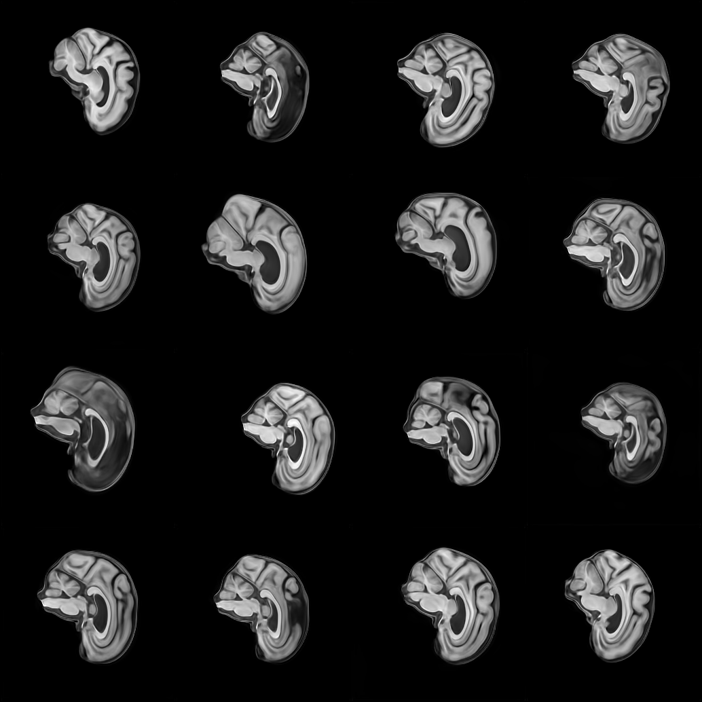

<br>

And here is a snapshot from the exact same latent vectors at the end of training (epoch 60):


<br>

Significant improvements of detail in brain matter are clear, even though structure and basic outlines are retained with precision. I believe is a sign of reasonable disentanglement of the latent space. 

To detect and alleviate model collapse, we provide a "mini-batch" of synthetic images to the Discriminator along with its standard deviation. If the standard deviation begins to collapse to 0, the Discriminator can immediately punish this, so model collapse is penalised heavily. We eventually find that mini-batch standard deviation from the synthetic images closely matches that of real images within 20 epochs of training. 

Training curves are presented with an $x$-axis of "images shown to the Discriminator (x1000)". This is linearly proportional to the number of training episodes and the number of epochs. 

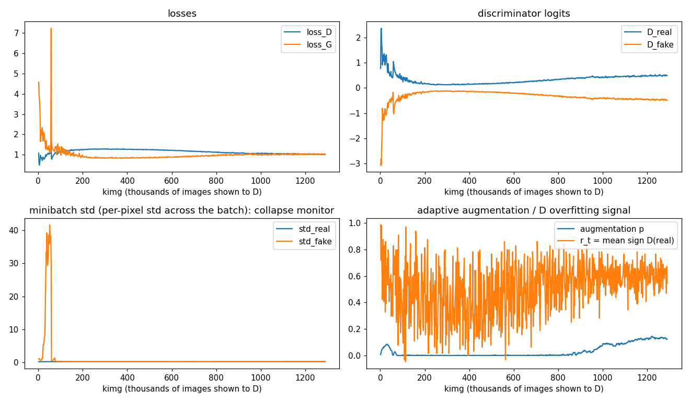

<br>

- **Losses:** As expected, the Generator initially has a really high loss because, well, it has no idea what it's doing at the start. Over time, we actually see a very clean and level convergence of the Generator and Discriminator losses, usually a sign that training further will not result in drastically new results. 
- **Discriminator Logits:** Obviously the Discriminator starts off with a really easy job of telling real scans apart from early garbage from the Generator, so its logits have high magnitude, demonstrating high confidence. Toward the second half of training, we see the logits slowly creeping back up, which indicates that the Discriminator is getting more confident with separating real from fake. This can be both good and bad for training (more in the adaptive augmentation part). 
- **Mini-batch variance:** This graph is supposed to show that synthetic images have about as much variance as real ones do, to prove that model collapse has been prevented. The graph, however, is not very informative because early generations had such high variance (producing nonsense garbage) that later runs seem to have zero variance. Howver, the real images have a similarly low variance, and actually inspecting the training [logs](training_log/log.csv) we can see that `std_ratio` stays very close to 1 after early epochs. 
- **Adaptive Augmentation:** A potential issue with GANs in general is that the Discriminator, instead of the Generator, will memorise the training scans, and simply reject anything that is not one of those scans, pixel for pixel, and get 100% accuracy. To alleviate this, we "augment" the data fed to the Discriminator by shifting the intensity of pixels by a small amount. If Discriminator loss decreases, or its confidence increases, disproportionately, we increase the intensity of augmentation, and if otherwise, we decrease it. The target augmentation value of 0.6 is a hyperparameter that I chose not to optimise because I don't casually have 64554789 hours to spend waiting for 238901 different training loops to complete. Here, `r_t` is effectively a measure of how accurately the Discriminator classified the real images, and this informs the decision of `aug_p`. As you can see, toward the end as the Discriminator started becoming more confident, we started to increase `aug_p` to combat its potential overfitting. 

For comparison purposes, I also included a baseline generator, which was a Variational Autoencoder trained over 30 epochs. A variational autoencoder is an improvement over the traditional autoencoder in that it samples from a distribution over its latent space, instead of sampling deterministically.  The VAE took about 6 minutes to train on an A100 using about 12.4GB of GPU RAM. By contrast, the StyleGAN-2 trained in approximately 7 hours using 28.4 GB of GPU RAM. 

Here is a snapshot from the latent space of the VAE at the end of epoch 10:

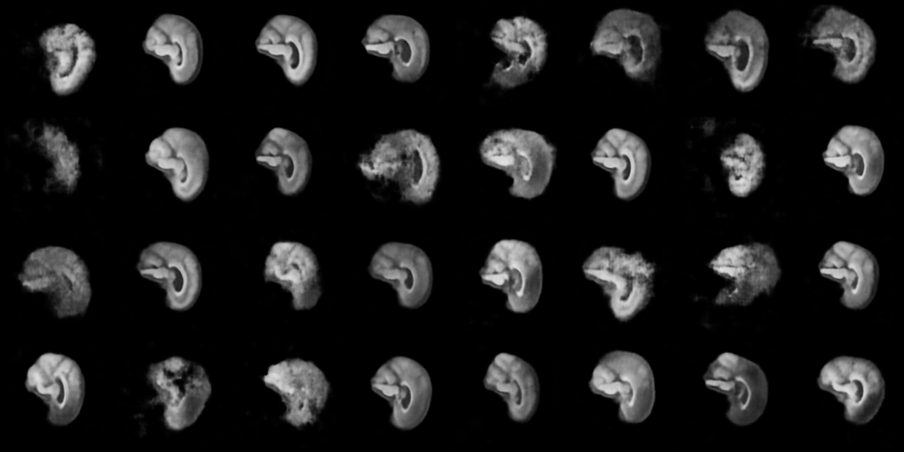
<br>

And here is one from the final epoch (30):

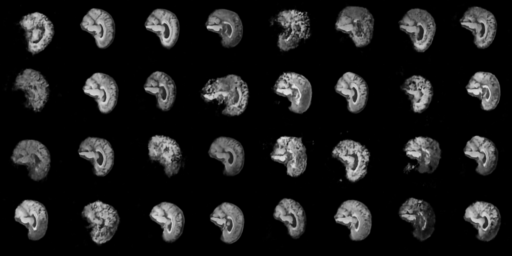
<br>

It is clear that the VAE also sees significant improvement over training but generated images remain unsharp, with little detail and much looser reconstruction of anatomical details and overall structure. A proper side-by-side and quantitative comparison with the StyleGAN-2 is in the next section. 

### Evaluation Metrics

Many methods were used to evaluate the performance of the StyleGAN-2, both with comparison against seen and unseen data. 

#### Comparison Against Baseline

| Metric | Real Images | VAE Baseline | StyleGAN-2 | 
| - | - | - | - |
| sharpness (Laplacian var.) | 1.000 | 0.018  | 0.874 |
| high-frequency spectrum vs real (log10) | 0.000 | -2.167 | -0.026 |
| diversity: mean pairwise feature distance | 12.942 | 14.132 | 12.431 |
| diversity: per-pixel std across samples | 0.079 | 0.067 | 0.084 |
| fidelity: precision (samples inside real manifold) | nan | 0.094 | 0.707 |
| diversity: recall (real covered by samples) | nan | 0.003 | 0.480 |
| fidelity: Frechet distance to held-out real | 5.704 | 25.109 | 11.845 |

The StyleGAN-2 far outperforms the baseline model in every measured respect, including diversity, sharpness and fidelity measures. We can also see this by inspecting the generated images more closely.

This is a grid of random samples from real, VAE and StyleGAN-2 generated images:

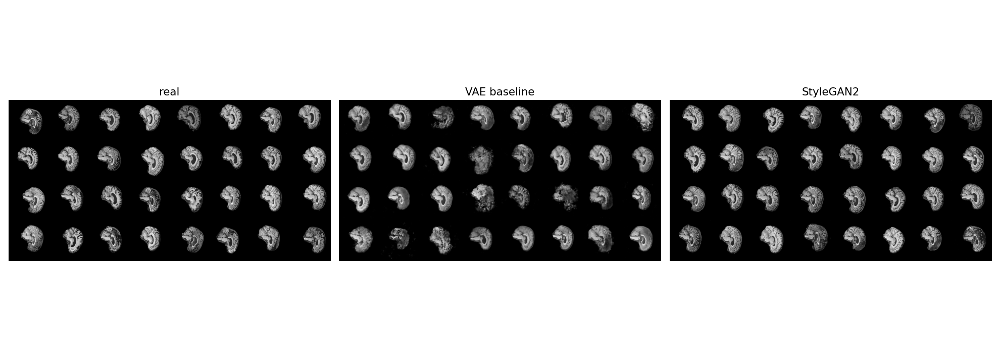

This is a nearest-neighbours comparison, where synthetic images from particular points in the latent space for both the VAE and StyleGAN-2 are compared with their closest real held-out images:

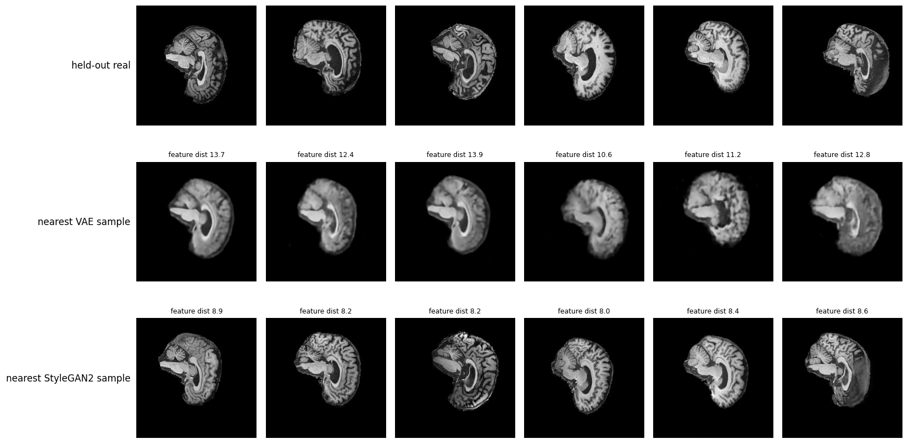

We immediately see a strong possibility that StyleGAN-2 images are "closer" to real images overall. 

And finally, to get a proper closer look at the details from either generator, here is a random sample of zoomed-in images:

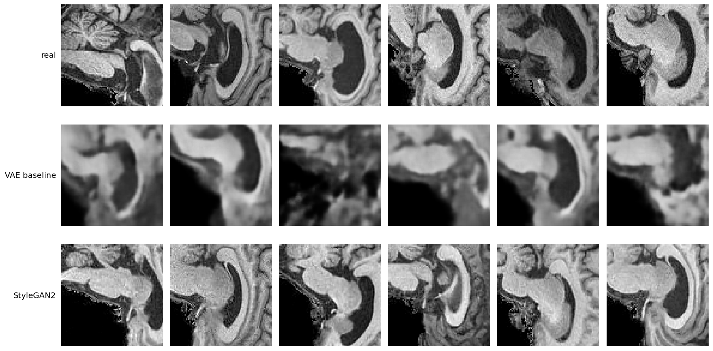


This, along with the quantitative measures of fidelity and sharpness, make it abundantly clear that the StyleGAN-2 is a significant and required improvement over the baseline. In terms of the original engineering dilemma, I think this is sufficient to demonstrate that the StyleGAN-2 is worth the increased compute resources over the baseline model in order to better address the research question requirements. However, it is necessary to now inspect and scrutinise the StyleGAN-2 outputs further to ensure the latent space is appropriately disentangled, diverse, and anatomically precise. 

#### Nearest-Neighbours Audit

For a thousand randomly sampled synthetic images, we perform a nearest-neighbours search for the closest training scan. The NN distance is calculated first in pixel space, the most rudimentary form, and then in ResNet-18 space. This is done by loading a pre-trained ResNet-18, removing its classification layer, and performing NN calculations based on the outputs of its final remaining layer (which only has 512 nodes, so this acts a bit like PCA). The idea there is that ResNet-18 distance will ignore things like small translations (which would greatly separate two otherwise identical images in pixel space) and focus on core attributes of the image. 

We measured distance from the synthetic images to their nearest training images, then distances between distinct train images for a baseline idea of expected distance, and distances between test images and train images for a reasonable upper bound on the expected distances.

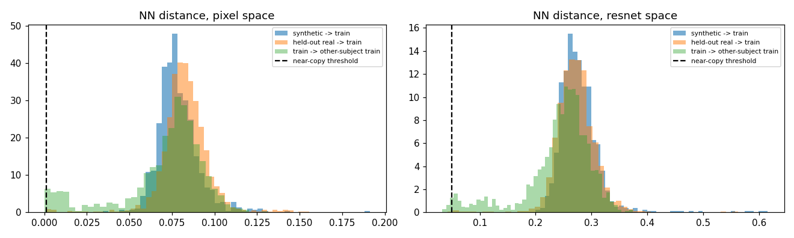

The graphs make it abundantly clear that synthetic images behave exactly as intended in terms of not memorising training data, but being reasonably close, just like the held-out test images. In ResNet-18 space we see an even stronger normal distribution overlap, which is expected once we remove the inaccuracies of measuring distance pixel-by-pixel. 

#### Latent Space Interpolation

Here we try to verify that the latent space is appropriately disentangled and that different directions in the latent space genuinely encode different attributes in a smooth way. We pick a random real image, use gradient descent to find the point in the latent space of the StyleGAN-2 which would correspond most closely to that image, then linearly interpolate this point to another (random) point in the latent space. We do this for training scans and test scans alike. 

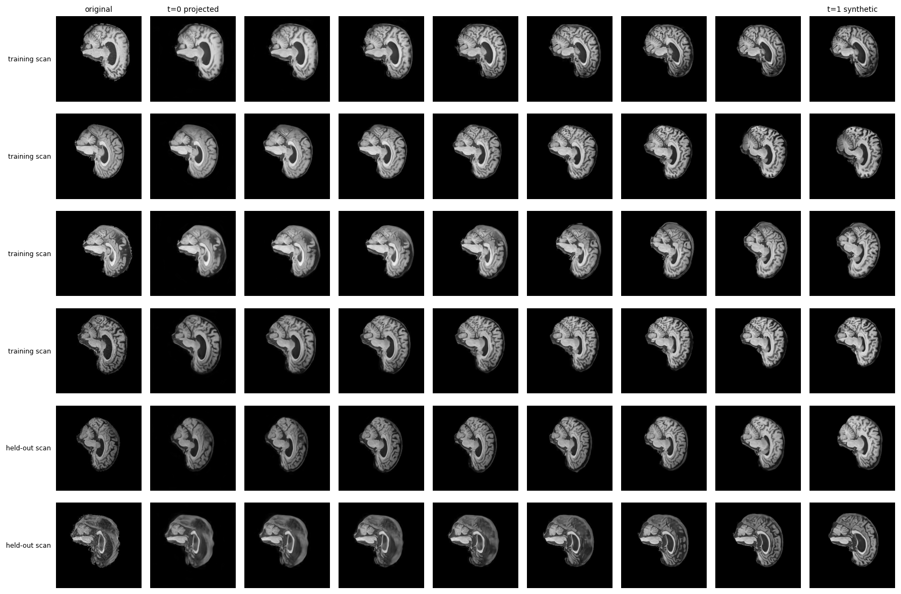

Not only do all the interpolations look smooth and reasonable, there seems to be no noticeable difference in performance between train and test images, enforcing the conclusion that the model is able to produce genuinely novel but realistic images without overfitting. The smoothness of the interpolation also means it has been able to learn a smooth latent space where different directions control certain distinct attributes of the image in a smooth way. 

#### Segmentation Masking

The last, and arguably most important part of evaluating this kind of image generation, is finding a way to ensure that anatomical structure is preserved. This approach was presented to me by a tutor during my feasibility review. 

The idea is to use a pre-trained segmentation mask, which takes in an MRI slice and segments the scan into areas of white matter, grey matter, cerebro-spinal fluid, background, and perhaps other areas (depending on the segmentation mask itself) - and run it on both real train/test images and synthetic images. After this, we compute the Dice-Sorensen coefficient between masks to evaluate how similar they are. If synthetic scans do preserve anatomical structure, the key areas identified by the segmenter should be in the same spots, and the DSC should be high. 

The main problem here, however, came from searching for suitable segmenters. Of course, I was unable to train my own without existing segmentation masks associated with the ADNI training images, which, if they exist, I do not have access to. Some segmenters exist online; however, they were unable to properly segment training images, some because they were designed for 3D DICOM MRI files, and others because they were designed for axial scans instead. Unfortunately, I could not find an online segmenter trained on exactly the kind of sagittal brain segments in my training data.  

##### Tissue Intensity

This is not an actual segmenter, rather, a classifier based on the intensity (brightness) of the tissue pixel in the scan. Unsurprisingly, the "segmentations" still look pretty legitimate although it must always be kept in mind that they are not actual segmentations: two areas can have the same brightness but represent two completely different anatomical components of the brain. I include this in the results as a baseline before introducing the other attempted segmenter. 

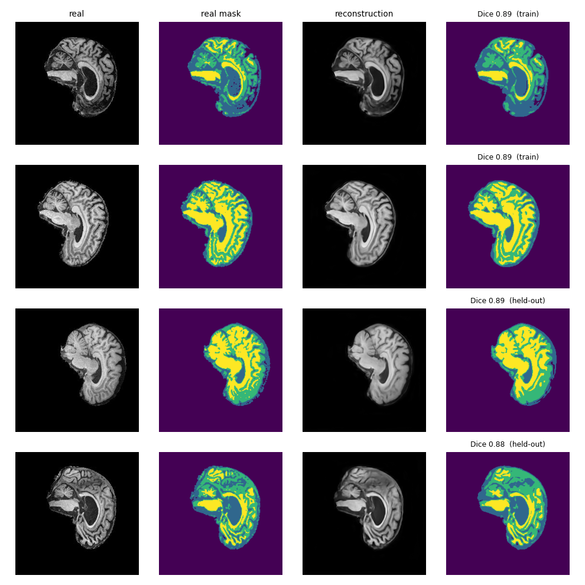

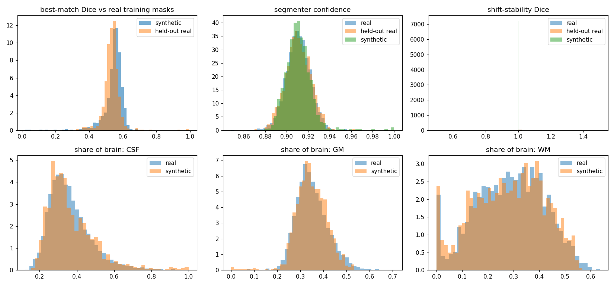

Ideally we hope for a Dice score above 0.9. Especially in the last held-out scan, we can see that the StyleGAN still fails to reproduce some of the finer details. However, the histograms show that this "segmenter" treats synthetic images almost exactly like real ones, with the distribution of CSF/GM/WM presence in the scans being almost identical for synthetic and real images. "Shift-stability" refers to how invariant the segmentation is under small changes: we measure the DSC between both the segmentation of the original image, and the segmentation of a small translation of that image (re-translated back so the two masks overlap). 

##### Pre-trained OASIS Segmentation Mask

The most successful actual segmenter on this dataset was actually my OASIS axial scan UNET segmentation mask from COMP3710 Demo 2. However, this was trained on axial scans, not sagittal, so it was far, far from perfect, or even feasible as a segmenter on sagittal. So you can imagine how bad the others must have been for this one to be the best I could come up with. 

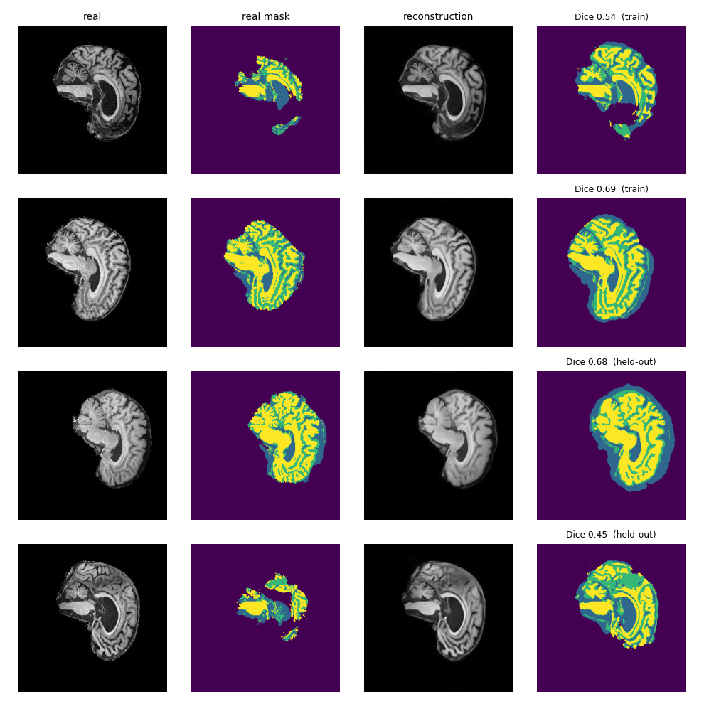

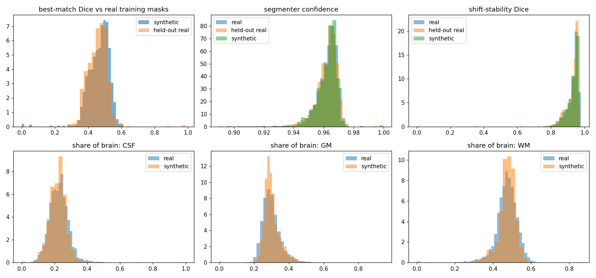

The histograms still show that synethic images are treated similarly to real ones, although the shift-stability plot reveals that this mask is much less stable under small variations - which makes sense given how different this data is to what it was trained on. As you can see, the DSC scores are quite poor, but it is also evident that this is a problem with the segmenter, not with the synthetic images themselves, because even on real images it is unable to provide a consistent or accurate segmentation, with the most obvious fault being that a lot of things that are clearly not the background are being mistaken for the background.  

### Final Engineering Recommendation

We have conducted extensive testing on the trained StyleGAN-2 model and concluded that it has *not* memorised training scans, so patient-confidentiality will not be violated. Through latent space interpolation we have also concluded that the latent space is likely well disentangled with dimensions clearly (and in fact smoothly) corresponding to specific attributes of the scans. This means that in theory, one can produce images with higher prominence of a certain attribute, while still being clinically plausible, if desired. 

We have also determined that the StyleGAN-2 is a significant improvement over baseline models like a VAE, making it potentially worth the added training resources, although this is up to the discretion of whoever wants to pay for the GPUs. In the grand scheme of things, 7 hours of training is not a long time especially when it only needs to be done once. It cost me barely $10 on Google Colab Pro to run this entire project with plenty of GPU RAM and compute units to spare, so I'm sure an engineering team can afford it. 

However, anatomical faithfulness, which is the most important factor in determining whether a scan is truly viable, could not be verified. The only foreseeable amendment to this is to train a segmentation mask specifically on the ADNI data and then re-run the same evaluations to inspect the Dice coefficients. Because of the potentially drastic negative impact of a synthetic but anatomically inaccurate scan being used in open research, my recommendation is that the team **do not** use the StyleGAN-2 as trained until a segmentation mask is also trained and used in evaluation as I have outlined. 

## Acknowledgements & References

Information on GAN, StyleGAN and StyleGAN-2 architecture:

- COMP3710 lecture slides. 

- https://medium.com/@arijzouaoui/stylegan-explained-3297b4bb813a

- https://blog.paperspace.com/understanding-stylegan2/

- https://arxiv.org/abs/1812.04948

- https://arxiv.org/abs/1703.06868

- https://arxiv.org/pdf/1912.04958

Information on the Dice-Sorensen Coefficient:
 
- https://en.wikipedia.org/wiki/Dice-Sørensen_coefficient

Other segmentation mask options that I looked at:

- https://pypi.org/project/DARTSeg/
- https://huggingface.co/kiselyovd/brain-mri-segmentation 
- https://github.com/nanand2/deeplab_mri_seg

## Artificial Intelligence Usage Disclosure

Large Language Models (Claude Sonnet 5.5) were used to generate almost all parts of the code used in this project. I personally verified the architecture of the models and the output plots were as I intended. I ensured that any generated code came with `QUICKTEST` options so I could quickly verify that it works the way I intended before running a large operation like a full training loop. I also ensured model checkpoints were saved every 5 epochs to not lose progress.  