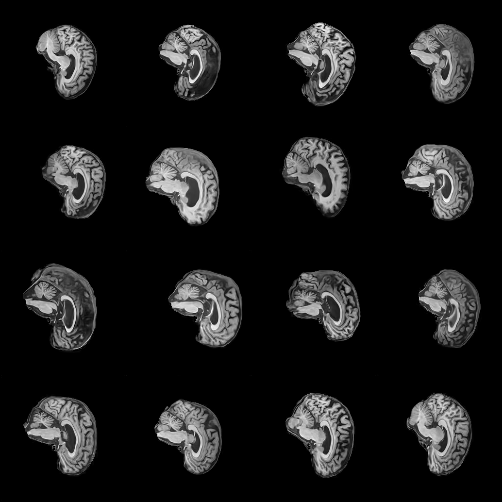

# StyleGAN-2 for Sagittal MRI Generation trained on ADNI

This report outlines documentation for the usage and the results of the image generation project for COMP3710. 

## Introduction

The project itself implements a StyleGAN-2 neural network architecture to generate clinically viable sagittal brain MRI scans from training on the ADNI dataset. The goal of the project is to determine whether it is possible to produce clinically viable synthetic brain MRIs, in order to bypass patient confidentiality restrictions that limit availability for open research. The scope of the project was tightened in numerous ways:
+ The model does not learn to replicate brain tissue around the brain: training scans have been modified so that only the brain is visible and all surrounding details have been excised.  (*)
+ The model is trained on sagittal-axis MPRAGE brain MRI scans with T1 weighting **only**.
+ Although a full MRI scan covers every slice of the head, scans with very little tissue (e.g. close to the ears) are excised from training data. Additionally, the model does not learn to attach a slice position to its generated images. Thus, it is only capable of performing independent single-slice generation, not a consistent 200-slice 3D MRI for a single synthetic person. 
+ The model is not trained on raw DICOM files, rather processed JPEG files. The model also outputs JPEG files only. (*)

(*) An asterisk indicates that this limitation of scope was chosen and implemented after the feasibility review. 

#### Feasibility Review
See the [feasibility review](../feasibility.md) document. 

## Structure
The files in the project folder `recognition/StyleGAN-s4801123` are structured in the following way:
```
.
├── dataset.py                  # set-up & data processing
├── dicom_conversion.py         # converting DICOM images to PNG. This was not used for the final version of the model. 
├── evaluate-segmentation.py    # Evaluate generated images using segmentation masks
├── evaluate.py                 # Evaluate generated images using other methods. 
├── evaluation_log
│   └── # PLOTS FROM EVALUATION
├── modules.py                  # components of the GAN
├── README.md                   # this file
├── requirements.txt            # packages required to run scripts
├── train.py                    # training loop
└── training_log
    ├── curves.png              # plots from training
    ├── log.csv                 # log of train losses
    └── samples
        └── # SAMPLES FROM LATENT SPACE MID-TRAINING
```


## Installation & Usage 
This project was completed on a single Google Colab notebook using an A100 GPU; however, it can be replicated in this format simply doing the following:
- Ensure you have access to an A100 GPU (else the `dataset.py` file will interrupt and exit). 
-  Change the `DATA_SOURCE`, `UNZIP_TO`, `OUT_DIR` and `RUN_DIR` constants in the `dataset.py` file to the appropriate directories on your local machine.
- Run each file in sequence:
    1. `dicom_conversion.py path/to/src path/to/dest/` (only if starting with DICOM files) 
    2. `dataset.py` (assumes training data is split into `train/AD` and `train/NC` like it is on rangpur), 
    3. `modules.py`, 
    4. `train.py` (optional; this will continue training from the last saved model in `OUT_DIR`), 
    5. `evaluate.py`, and finally 
    6. `evaluate-segmentation.py`.  
The files in this repository were updated in line with the Colab script. 

The requirements to run this project are outlined in `requirements.txt`. You may install these requirements with `pip install -r requirements.txt`. You may comment out the relevant portions of `requirements.txt` if you do not intend to use the DICOM converter (i.e. if you're starting with processed PNGs or JPEGs). 

## Algorithm

### StyleGAN-2 Overview

This section assumes basic understanding of generative neural network structures, such as VAEs. 

A GAN (Generative Adversarial Network) is a neural network designed (usually) for image generation with two competing components:

1. A Generator, which samples from a latent space with the purpose of generating realistic images based on its training data,
2. A Discriminator, with the purpose of discriminating real training images from images produced by the Generator. 

Both components are themselves neural networks trained simultaneously by pitting them against one another: the Generator produces a batch of images, and these, along with real training images, are fed to the Discriminator. The loss of the Generator & Discriminator are both calculated from the accuracy of the Discriminator.  

GANs can be notoriously difficult to train because training losses do not converge to 0. and can often run into problems such as model collapse, where the generator learns to replicate a single training image (or a select few thereof) instead of truly learning to produce authentic new images. There are numerous methods to detect and penalise this, which will be discussed in the training & evaluation sections. 

Crucially, the Generator of a GAN, when fully trained, learns a (hopefully) "disentangled" latent space, where each dimension of the latent space is independent and controls only one "aspect" or attribute of the image (in the case of brain MRIs, one such attribute might be, perhaps, the shape or length of the hippocampus). 

The StyleGAN is a drastic improvement over the traditional GAN, with the following key differences (briefly outlined, see the full paper in [References](#acknowledgements--references) for details):

1. It introduces a *new intermediate latent space* (usually called $w$), placed between the first latent space (denoted $z$) and the actual image generation. A mini-neural-network (called the *Mapping Network*) takes you from $z$-space to $w$-space. The space $w$ is better disentagled than the space $z$, producing more accurate and flexible images. 
2. Between $w$ and the actual image generation, there sits a (learned) affine (meaning linear + a translation) transformation to map $w$-vectors to *style* vectors.  
3. Style vectors are the processed through a *Synthesis Network*, which incorporates normalisation of styles (AdaIN), some noise for stochasticity, and style-mixing to ensure styles stay independent, to finally produce images.

Subsequently, StyleGAN-2 fixed some of the residual issues of the original StyleGAN, including:

1. The AdaIn normalisation from StyleGAN allowed some unwanted droplet-shaped artefacts to persist throughout the network and appear in generated images. Restricting the use of AdaIn appropriately mitigated this issue. 
2. As we travel along a fixed direction in the latent space of the StyleGAN, some features (styles) did not evolve in sync (i.e. stayed fixed). 
3. A skip connection was added in the Generator. 

### Training Process

Data was split into approximately 20k training images and 10k held-out test images with no patient leakage between train and test sets. Training was split into 60 epochs with a batch size of 32. At every 5th epoch, we saved a snapshot of images produced from a consistent set of latent vectors. 

For example here is a snapshot from the end of epoch 10:


<br>

And here is a snapshot from the exact same latent vectors at the end of training (epoch 60):



<br>

Significant improvements of detail in brain matter are clear, even though structure and basic outlines are retained with precision. This is a sign of reasonable disentanglement of the latent space. 

To detect and alleviate model collapse, we provide a "mini-batch" of synthetic images to the Discriminator along with its standard deviation. If the standard deviation begins to collapse to 0, the Discriminator can immediately punish this, so model collapse is penalised heavily. We eventually find that mini-batch standard deviation from the synthetic images closely matches that of real images within 20 epochs of training. 


<br>

### Evaluation Metrics

### Final Engineering Recommendation


## Acknowledgements & References

https://medium.com/@arijzouaoui/stylegan-explained-3297b4bb813a

https://blog.paperspace.com/understanding-stylegan2/

https://arxiv.org/abs/1812.04948

https://arxiv.org/abs/1703.06868

https://arxiv.org/pdf/1912.04958

## Artificial Intelligence Usage Disclosure